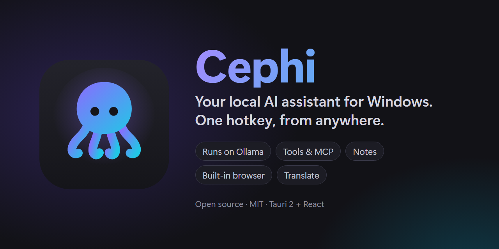
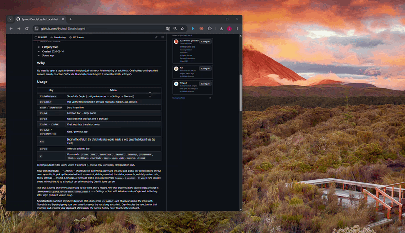

<p align="center"></p>

**Your whole PC, one hotkey away.** Press `Ctrl+Alt+Space` anywhere, say what you want, and Cephi does it.
Runs on your own machine, free and open source.

> *"play Another Love by Tom Odell"* · *"open display settings"* · *"turn it down"* ·
> *"translate Eichhörnchen"* · *"? best budget mechanical keyboard"* · *"note down: call mum tomorrow"*

<p align="center"></p>

- 🎵 **Plays your music.** Ask for any song on Spotify, then pause, skip or set the volume, all without leaving what you're doing.
- ⚙️ **Opens anything for you.** "Open Bluetooth settings", "change my wallpaper", "launch Discord": no more clicking through menus.
- 🧠 **Any AI you like.** Local models with Ollama, so nothing leaves your PC. Or bring your own key for Claude, Gemini
  or any OpenAI-compatible API. Switch with one click.
- 🌐 **Search without switching windows.** A built-in browser, Google and YouTube, plus AI answers with their sources,
  right where you already are.
- 🌍 **Translate on the spot.** Select text in any app, press `Ctrl+Alt+T`: translate it, explain it, or ask about it.
- 📝 **Notes and checklists** in the style of Google Keep, and the AI can save and find them for you.
- 🔌 **Grows with you.** Connect any MCP server, or add your own tool with a single JSON file.
  Screenshots and offline dictation are built in too.

**[⬇ Download for Windows](../../releases/latest)** · [Getting started](#getting-started) · [What it can do](#usage)

## Usage

| Key | Action |
|---|---|
| `Ctrl+Alt+Space` | Show/hide Cephi (configurable under ⋯ → *Settings* → *Shortcuts*) |
| `Ctrl+Alt+T` | Pick up the text selected in any app (translate, explain, ask about it) |
| `Enter` / `Shift+Enter` | Send / new line |
| `Ctrl+E` | Compact bar ↔ large panel |
| `Ctrl+N` | New chat (the previous one is archived) |
| `Ctrl+1` … `Ctrl+4` | Chat, web tab, translator, notes |
| `Ctrl+Tab` / `Ctrl+Shift+Tab` | Next / previous tab |
| `Esc` | Back to the chat, in the chat: hide (also works inside a web page that doesn't use Esc itself) |
| `Ctrl+L` | Web tab: address bar |
| `/` | Commands: `/clear`, `/web …`, `/translate …`, `/model …`, `/history`, `/screenshot`, `/tools`, `/settings`, `/shortcuts`, `/keys`, `/mcp`, `/pin`, `/config`, `/reload` |

Clicking outside hides Cephi, unless it's pinned (⋯ menu). Tray icon: open, configuration, quit.

**Your own shortcuts:** ⋯ → *Settings* → *Shortcuts* lists everything above and lets you add global key
combinations of your own: open Cephi, pick up the selected text, screenshot, dictate, new chat, translator,
new note, web tab, earlier chats, tools, settings — or *send a message*. A message that is also a quick phrase
(`pause`, `? weather`, `tr word`) runs straight away, without the AI, so a shortcut can drive anything
Cephi's tools can do.

The chat is saved after every answer and is still there after a restart; *New chat* archives it (the last 50
chats are kept in `%APPDATA%\io.github.eyvind-desch.cephi\chats\`). ⋯ → *Settings* → *Start with Windows* makes Cephi wait in the tray
after login (installed version only).

**Selected text:** mark text anywhere (browser, PDF, chat), press `Ctrl+Alt+T`, and it appears above the input
with *Translate* and *Explain*; typing your own question sends the text along as context. Cephi copies the
selection for that moment and **restores your clipboard afterwards**. The normal hotkey never touches the clipboard.

**Dictation:** the microphone button next to the input records what you say and writes it into the input field
(offline via a local Whisper container, [setup](docs/VOICE.md)). `Esc` throws the recording away.

**Screenshot:** ⋯ → *Screenshot* (or `/screenshot`) freezes the monitor the mouse is on — Cephi hides itself
for the shot — and lays it over the screen: drag a rectangle to pick a part, `Enter` takes the whole monitor,
`Esc` throws it away. The cut-out lands above the input: *What is on it?* or your own question about it.
You can also paste a picture from the clipboard (Snipping Tool, a copied image) into the input. This all
needs a model that can read pictures — Cephi knows which ones (cloud models, and local vision models
like `llava` or `…vl`), and the attached screenshot offers to switch to one. Pictures stay in the session: a saved chat never keeps a screenshot.

The panel has four tabs (icons top right, `Ctrl+1` … `Ctrl+4`): **Chat**, **Web**, **Translator** and **Notes**. The web tab shows Google and other pages inside
Cephi (address bar: search terms or an address) and can be enlarged; links from the chat and search results open there too.
The notes tab keeps notes and checklists in the style of Google Keep (colours, pinning, search); "notiere …" /
"note down …" in the chat saves one, and the AI can look them up.

### Quick actions (no AI, instant)

| Input | Action |
|---|---|
| `öffne discord` / "open discord", `starte den rechner` / "launch calculator" | Launch app |
| `spiele another love von tom odell auf spotify` / "play another love by tom odell on spotify" | Play song ([setup](docs/SPOTIFY.md)) |
| `pause` / "pause", `nächster song` / "next song", `stumm` / "mute", `ton an` / "unmute" | Playback |
| `lautstärke auf 30` / "volume to 30", `mach 24 lauter` / "turn it up by 24", `mach es leiser` / "turn it down" | Volume (exact) |
| `tr word`, `übersetze …` / "translate …" | Offline translation German ↔ English ([setup](docs/TRANSLATE.md)) |
| `? search term` | Web search in Cephi: result cards + short AI answer with sources ([setup](docs/SEARCH.md)) |
| `g search term` | Google in Cephi's web tab |
| `yt search term` | YouTube in the browser |

Everything else goes to the AI, which can call the same tools. Custom quick actions: `triggers` in the
tool JSON files ([docs/TOOLS.md](docs/TOOLS.md)). Settings (⋯ → *Settings*, or `/settings`): general options, API keys and MCP servers, all without editing JSON.

## Getting started

You need **Windows 10 or 11** and [Ollama](https://ollama.com). Everything else is optional.

1. **Install Cephi:** download `Cephi_x.y.z_x64-setup.exe` from the
   [Releases](../../releases) page (no admin rights needed), or build it yourself (see *Install* below).
2. **Models:** the default profiles use three model names. Pull public models and give them those names:

   ```powershell
   ollama pull qwen2.5:3b;  ollama cp qwen2.5:3b assistant-fast   # "Fast"
   ollama pull qwen3:4b;    ollama cp qwen3:4b assistant          # "Smart": best with tools
   # "Thorough" (assistant-big) is optional: any large model, e.g. a 20–30B one, if your PC can take it
   ```

   Or point the profiles at models you already have: `profiles` in `settings.json` ([docs/PROVIDERS.md](docs/PROVIDERS.md)).
3. **Press `Ctrl+Alt+Space`** and ask something.

Optional extras, each with its own setup page: cloud models with your own API key
([Claude, Gemini, OpenAI-compatible](docs/PROVIDERS.md)), web search ([SearXNG](docs/SEARCH.md)), offline translation
([LibreTranslate](docs/TRANSLATE.md)) and dictation ([Whisper](docs/VOICE.md)). The last three run as local Docker
containers in WSL, and Cephi starts them for you. Plus [Spotify](docs/SPOTIFY.md) and any [MCP server](docs/MCP.md).

## Configuration

Everything lives in **`%APPDATA%\Cephi\`** and is reloaded immediately on changes:

```
Cephi/
├── settings.json   language, shortcuts, model profiles, AI providers, window, agent
├── tools/          custom tools as JSON → docs/TOOLS.md
├── mcp.json        MCP servers (tools from other apps) → docs/MCP.md
└── schemas/        for editor autocompletion (generated automatically)
```

`settings.json` also has a `"language": "system" | "en" | "de"` field (default `system`, which follows
the Windows display language). The UI and all messages are localized (English source, German translation).

## Install

```powershell
npm run app:build
.\src-tauri\target\release\bundle\nsis\Cephi_0.5.0_x64-setup.exe
```

The installer needs no admin rights (installs for the current user, German or English). Settings, tools and
keys are shared with the development build. Only one Cephi runs at a time, so close the dev version (`npm run app`)
before starting the installed one. After installing: ⋯ → *Settings* → *Start with Windows*.

## Development

Requirements: Node 22+, Rust (MSVC), VS C++ Build Tools, Ollama.

```powershell
npm install
npm run app          # dev mode with hot reload
npm run check        # TypeScript + Clippy + Rust tests
npm run app:build    # installer (NSIS) → src-tauri/target/release/bundle/
npm run clean        # throws src-tauri/target away (a fresh build takes ~4 minutes)
```

Custom config folder for testing: `$env:CEPHI_CONFIG_DIR = "X:\tmp\cephi-config"`.
Logs: `%LOCALAPPDATA%\io.github.eyvind-desch.cephi\logs\`.

**Build folder.** A debug build with symbols for every dependency reaches tens of gigabytes and
Cargo never prunes it, so dependencies are compiled without debug information (`[profile.dev]` in
`src-tauri/Cargo.toml`); our own code keeps line numbers, so panics stay readable. That keeps
`src-tauri/target` at about 3.5 GB instead of 60.

## Docs

- [PLAN.md](PLAN.md): goals, decisions, stages
- [docs/ARCHITECTURE.md](docs/ARCHITECTURE.md): structure and data flow
- [docs/TOOLS.md](docs/TOOLS.md): custom tools, quick actions, API keys
- [docs/SPOTIFY.md](docs/SPOTIFY.md): Spotify setup
- [docs/SEARCH.md](docs/SEARCH.md): web search (local SearXNG)
- [docs/TRANSLATE.md](docs/TRANSLATE.md): offline translator (local LibreTranslate)
- [docs/VOICE.md](docs/VOICE.md): dictation (local Whisper)
- [docs/MCP.md](docs/MCP.md): MCP servers (tools from other apps, Claude Desktop format)
- [docs/PROVIDERS.md](docs/PROVIDERS.md): cloud AI providers (Claude, Gemini, OpenAI-compatible)

## Contributing

Ideas, bug reports and pull requests are welcome; [CONTRIBUTING.md](CONTRIBUTING.md) explains the setup. Run `npm run check` before sending a pull request.
[CLAUDE.md](CLAUDE.md) lists the project's rules (thin IPC layer, translation keys in both languages, …), and
[docs/ARCHITECTURE.md](docs/ARCHITECTURE.md) shows where things live. New tools often need no Rust at all:
a JSON file is enough ([docs/TOOLS.md](docs/TOOLS.md)).

## License

[MIT](LICENSE)
